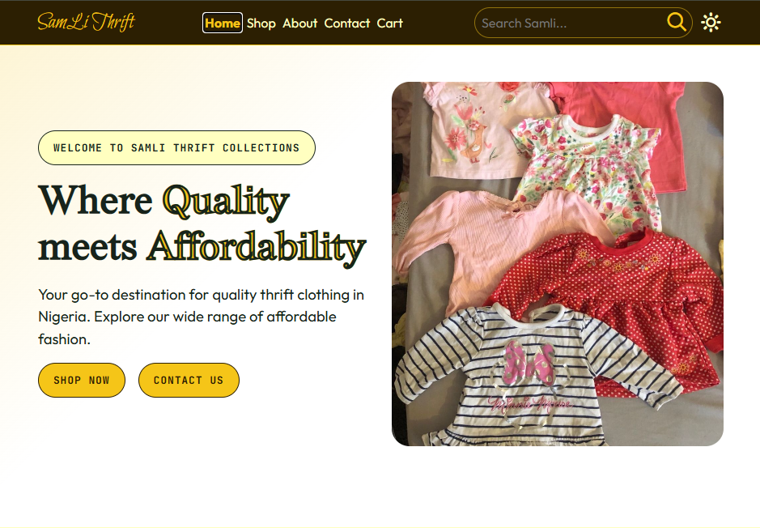
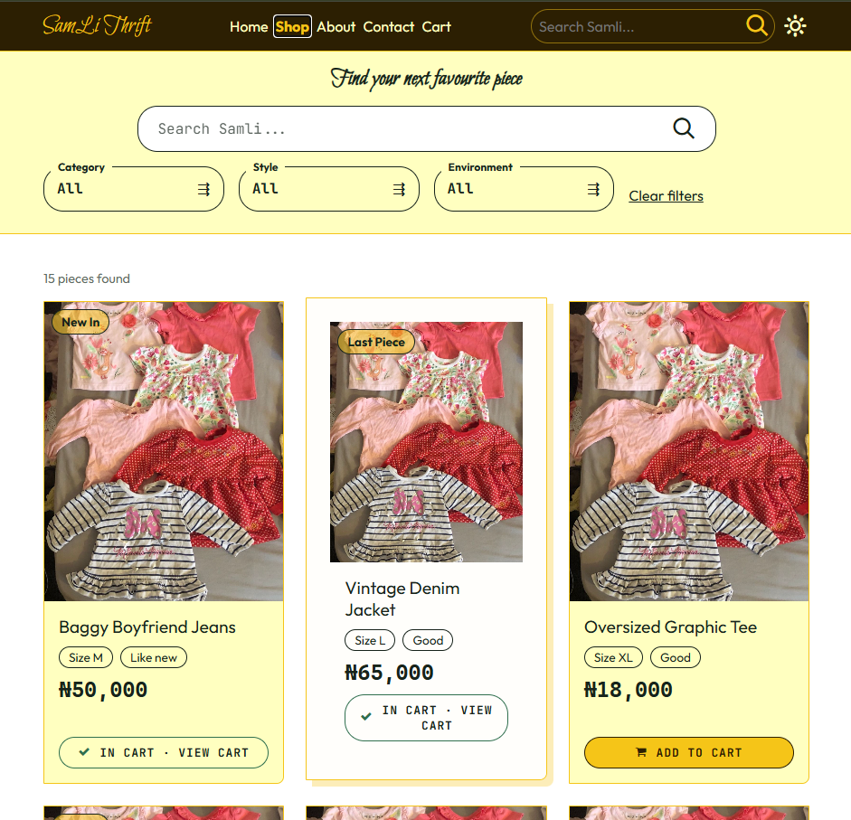
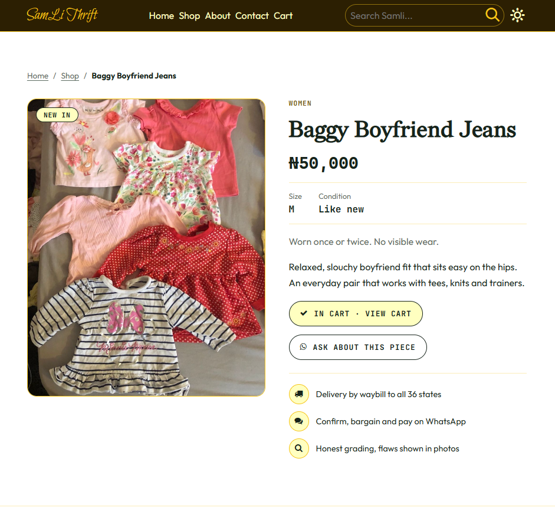
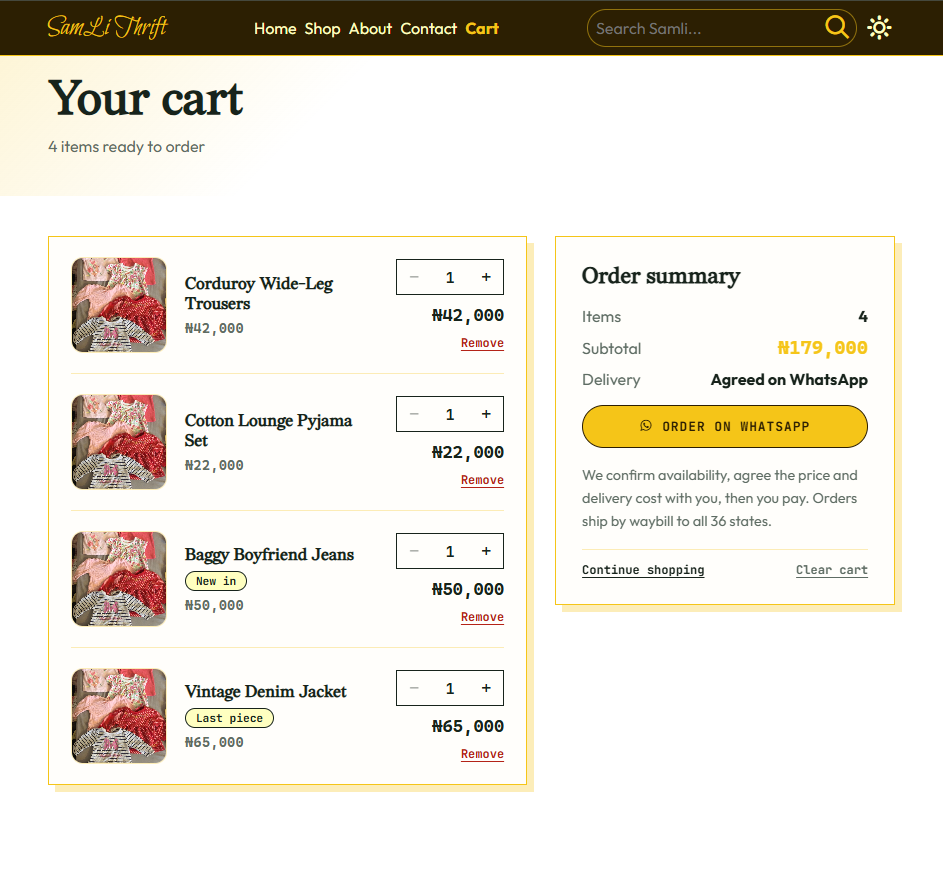

# SamLi Thrift

A thrift clothing storefront built for a real Nigerian seller whose customers order through WhatsApp. Visitors browse graded second-hand pieces, build a cart, and send the order straight to the seller as a prefilled WhatsApp message. The seller confirms availability, agrees delivery and payment, and ships by waybill to all 36 states.

**Live site:** https://samli-thrift.github.io/






## Why it works this way

The business sells through WhatsApp and Facebook groups: customers discuss the piece, bargain, then pay. The site is designed around that flow instead of a typical card-payment checkout:

- No payment gateway. The cart hands off to WhatsApp with the order already written out.
- Honest grading is part of the product. Every piece shows a condition (New, Like new, Good, Fair) with a plain-language explanation.
- One-off stock is expected. Sold items are flagged instead of silently ordered.

## Features

**Shopping**
- Shop page with search and filters for category, style and environment
- Reusable `ProductCard` with status badges, size, condition and sold-out state
- Product details page with photo gallery, grade explanation, description, related pieces, and an "Ask about this piece" WhatsApp link
- Friendly not-found state for bad or removed product links

**Cart**
- Cart persists across refreshes and browser restarts using `localStorage`
- Saved data is validated on load, so corrupted storage can't crash the app
- Multiple tabs stay in sync through the `storage` event
- On app load, saved items are checked against the live product list: prices and images are refreshed, and sold or removed pieces are flagged, left out of totals, and excluded from the WhatsApp message
- Quantity controls, line totals, subtotal, clear cart, and a disabled checkout when nothing can be ordered

**Checkout**
- One tap builds a WhatsApp message listing each item, quantity, line price and subtotal, ready to send to the seller

**Site**
- Home, Shop, Product details, Cart, About and Contact pages
- Home sections: hero, shop by category, featured products, why choose us, meet the owner, reviews, FAQs and a call to action
- About page with story, stats, process and CTA sections
- Responsive layouts and accessible controls (labelled buttons, live regions for quantity, keyboard focus styles)

## Tech stack

- **React** with **React Router** (`HashRouter`)
- **SCSS** with a small design system: shared mixins (`df`, `dg`, `btn`, `card-shadow`, `h2`, and others), design tokens as CSS variables, and a dark-mode theme through an `html.dark-mode` class
- **React Context** for cart and page state
- **Font Awesome** and **IcoMoon** icons, plus local web fonts
- Hosted on **GitHub Pages**

## Project structure

```
src/
├── assets/            images, fonts, icon sets
├── components/        Navbar, Footer, ProductCard, ...
├── context/
│   ├── CartContext.jsx    cart state, localStorage, stock sync
│   └── PageContext.jsx
├── data/
│   └── products.js        product catalogue (named export)
├── pages/             Home, About, Shop, Contact, Cart, ProductDetails
├── scss/
│   ├── components/
│   ├── pages/
│   └── util/              variables, mixins, shared page mixins
├── App.jsx            providers and routes
└── main.jsx
```

## Getting started

```bash
# install dependencies
npm install

# start the dev server
npm run dev

# production build
npm run build

# preview the production build locally
npm run preview
```

## Managing products

Products live in `src/data/products.js` as a named export:

```js
export const products = [
  {
    id: "p101",
    image: photo,                 // imported image
    images: [photo, photo2],      // optional: gallery on the details page
    name: "Baggy Boyfriend Jeans",
    price: 50000,                 // naira
    size: "M",
    condition: "Like new",        // New | Like new | Good | Fair
    status: "New in",             // optional badge
    soldOut: false,               // optional
    category: "women",
    style: "trending",
    environment: "casual",
    description: "Short, honest description of the piece.",
  },
];
```

- `category`: men, women, children, babies, girl, underwear, swimwear, night-wear
- `style`: hot, sexy, punk, trending
- `environment`: everywhere, work, school, casual
- Set `soldOut: true` to mark a piece as sold. Customers who saved it in their cart will see it flagged the next time they open the site.

## Configuration

Set the seller's WhatsApp number (country code, no `+` or spaces) in:

- `src/pages/Cart.jsx`
- `src/pages/ProductDetails.jsx`

## Design decisions

**HashRouter.** GitHub Pages is a static host and has no server-side routing, so a `BrowserRouter` URL like `/shop` returns a 404 when opened directly. A `HashRouter` (`/#/shop`) works on any static host with no redirect setup. The trade-off is that WhatsApp and Facebook ignore everything after the `#`, so all pages share one link preview (set through Open Graph tags in `index.html`).

**Cart stores a slim item, then re-syncs.** Only the fields the cart needs are saved. On load, each saved item is matched against the live product list, so price changes, new image URLs after a redeploy, and sold items are handled instead of going stale in a customer's browser.

**Sold items are flagged, not deleted.** Removing a piece a customer was planning to buy without explanation is confusing. The cart shows what happened and lets them remove it with one click.

## Known limitations

- Stock status lives in the data file, so marking a piece sold means editing `products.js` and redeploying. A customer can still order something that sold after their last visit, which is why the WhatsApp message asks the seller to confirm availability.
- All pages share a single link preview because of the hash router.
- No backend: no accounts, order history or online payment. This is intentional for the current business flow.

## Possible next steps

- Move products to a small backend or a spreadsheet so stock updates don't need a redeploy
- Per-product link previews (needs `BrowserRouter` plus prerendering)
- Analytics on product views and add-to-cart events
- Error boundary and a 404 page for unknown routes

## Author

Built by [Your Name](https://github.com/Ehiejakhian).